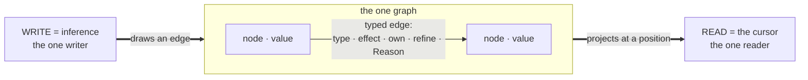

# Mentl Space — the interaction architecture

> This document is the companion to `DESIGN_SYSTEM.md`, which defines the
> brand, the design tokens and the visual language. Read that document first,
> because this one assumes it. The design system covers how Mentl looks. This
> document covers an earlier question: what should an IDE be when the program
> is a graph, text is one of many projections of that graph, and the
> intelligence comes from the compiler? It is the design for Mentl's felt
> aspect, the part a person works with directly (PLAN §5, FELT). It is not
> required reading. Question it rather than accept it as settled.
>
> How to read the tags: ground rule 1 of this design is that a view belongs in
> the IDE only if it names the cursor mode it runs in (PLAN §2's subsystem
> table) and the aspect it projects. Every surface below carries that tag in
> the form *(cursor mode · aspect)*. There are eight aspects, drawn together as
> an octagon. Each has a two-part name: the kernel primitive, then what the
> cursor does with it:
>
> `graph·query` · `handler·propose` · `verb·topology` · `row·unlock` ·
> `ownership·trace` · `refinement·verify` · `gradient·teach` · `reason·why`.

---

## 0 · The thesis

Every IDE built so far is an application wrapped around a text buffer, with
panels that describe the code, a compiler that runs behind it and an assistant
beside it. Mentl Space reverses that arrangement. The IDE is a projection of
the program's own graph, made for a person to read. There is one graph.
Inference is the only writer, and the cursor is the only reader. Everything on
screen (the text, the topology lines, the row matrix, the Why chain, the
proposals) is that same read shown at a different level of detail. Every view
stays live, because re-projecting when the graph changes uses the same
machinery as incremental compilation (§4⑦: reactivity is the cursor's `<~`).

Every decision below follows from one consequence: each panel is a cursor
mode, not a separate feature. Click anything in any projection and the cursor
moves there, and every other projection re-projects around it. There is one
point of attention at N levels of detail, and no synchronization code, because
every view reads the same graph.

The design centers on the loop a person works in, not on files:

```
type            →  the buffer takes a keystroke
project          →  the graph updates; every surface re-derives (the IC cursor's <~)
propose          →  the gradient reads the ?? socket; the medium fans proven survivors
accept           →  Tab draws a patch edge; the loop re-projects around it
```

That loop is the whole product. Files are a serialization of the graph, and a
person's mental model is the loop, not the files.

Finally, Mentl Space is itself a Mentl program, and that is what makes the
design future-proof. It is the loop that SYNTAX.md writes in its own
composition sketch:

```
keystroke
  |> tokenize
  |> parse_to_graph
  ~> format_default
  ~> render_to_transport
    <~ accumulate(graph)
```

Nothing in the IDE is built outside the language either. There is no plugin
API, because the language is the plugin API: a theme is a `Render` handler, a
keybinding is a handler on the `Input` effect, a custom pane is a projection
function, and a "linter" is a handler on `Verify`. Extending the IDE means
writing Mentl, so the compiler proves each extension's effects with the same
row checks as any other code. A plugin cannot reach the network without that
showing in its row (`!Network` is checkable), and it cannot touch anything its
row leaves out. In VS Code's extension marketplace, users have to trust each
extension; in Mentl Space, the compiler proves what each extension can do.

A decision on 2026-10-05, recorded as THE VIEW IS A PROJECTION, puts this
design into practice: the page is a host, and the wheel renders the IDE. Each
page runs one resident session (the session role of `ide/wheel-worker.js`,
reached over a shared-memory channel through its host side,
`ide/session-client.js`). Each input event (opening a project, moving the
caret, changing the text, an accept, choosing a surface) goes to the session
as one line, and the session answers with the View. The View is a structured
tree that carries the ring's eight facets with their spans and provenance, the
Lens (the ranked teaching step and the diagnostics with their addresses), the
Ledger's bands, the module map, the gutter cells, the token spans, the verb
geometry and the trail. `src/space.mn` computes it from reads that already
exist (`CursorView`, the diag bank, `audit`, `where`, `query`, `why`,
`verify`), and each fact carries the degree of interest at which the page
draws it (§3). The JavaScript that remains is only a host: the WASI shim, the
channel, the textarea and one generic painter keyed by element id. The CLI's
stdio session and the LSP are the other two transports for the same
projections. So a facet added to the wheel reaches the page with no change to
the page, and every regular expression in the page that parses the wheel's
prose can be deleted. Since L-C (2026-10-06), the wheel's answer has carried
the Ring, the Lens and the Ledger, and the page parses none of the wheel's
prose. The canvas's tokens and spans, the gutter cells and the verb geometry
(L-D), then the module map and the trail (L-E), join the same answer next, and
each intermediate step ships on its own.

---

## 0.5 · The five surfaces — the map of this document

Everything the page shows belongs to one of five surfaces, and each surface is
a reading of the one cursor. A design proposal that fits none of them is
decoration (§9).

| Surface | What it projects | Cursor mode · aspect | Where |
|---|---|---|---|
| **The canvas** | the text, the aspect strip in its gutter, the overlays on it, the socket at a hole | projected · all eight | §3 |
| **The program's shape** | the geometry of the five verbs (chains, fans, enclosures, sealed `!E` walls, loops) with the rows drawn over it, at every level from a declaration to a module | projected · verb·topology + row·unlock | §4.2 |
| **The codebase's shape** | the module map banded in three colours (provably absent · present · not yet provable), the dead weight, the ghosts, the imports as the project's manifest | verified · graph·query | §4.3 |
| **The time axis** | the trail with its forks (the fan's survivors, a schedule's branches, a continuation's suspensions) and persisted images as bookmarks you reopen | forked · handler·propose | §4.4 |
| **The Why ink** | provenance drawn from any fact back to the edit, install or axiom that produced it, with trivial hops left out | reasoned · reason·why | §3.5 |

---

## 1 · The essence — a lens you look through

One sentence sums up the design: you should look through Mentl Space at your
program, and never at Mentl Space itself. The program should be visible and
the language invisible. When this works, the developer stops noticing the
medium and sees only their computation: its shape, its declared guarantees,
and the one place where it is suspended, waiting for their input.

That experience does not come from visual polish. Four invariants produce it,
and breaking any one of them breaks it. Every surface, interaction and
portrait in this document must obey all four.

1. **Every pixel is a live read of the graph.** No surface caches a fact the
   graph holds, and nothing on screen is derived again from a stale copy. If a
   display and the graph disagree, the display has a bug; the difference is not
   a delay to tolerate. This is the Carried-Truth Law applied to the screen. A
   panel that keeps its own model of the program shows you a second copy
   instead of the one graph.

2. **One cursor, at every level of detail.** Click any fact in any surface and
   the cursor moves there, and every other surface re-projects around it. No
   panel owns state, and no synchronization code exists, so nothing has to be
   kept in sync by hand.

3. **Layout is a projection of the program's shape.** The formatter projects
   the topology into the layout, and you never type the layout yourself. The
   five verbs determine the program's form on the page, and the formatter
   restores that form when you pause and when you save, never while you type.
   The projection must not take the keyboard away: in one earlier tool, users
   rated the editor that overrode their keystrokes as the tool's worst part,
   and it was removed. You read the computation graph directly from the
   indentation, so you see the program's structure without decoding the
   notation.

4. **The medium shows nothing it has not proven.** It shows one proven thing or
   nothing at all (voice.mn's `silence_predicate` reads the oracle queue, and
   when the queue is empty nothing is shown). An error appears as a socket to
   fill in, not as a message that blames you. "The compiler" never appears as
   a character; you see your program and the places where it needs your input.

To test a new idea, ask whether it lets the developer see more of their program
and less of Mentl. If it adds something else to look at, it fails, however good
it looks.

---

## 2 · What dissolves — the anti-IDE

Reaching the ultimate form mostly means removing things. Each fixture of a
conventional IDE works around a fact that its underlying tools do not carry.
Mentl's kernel carries that fact, so the fixture is no longer needed.

| IDE fixture | The missing fact it works around | What replaces it |
|---|---|---|
| **Files & the file tree** | no unit of meaning smaller than a file | Modules are regions of the graph, and the "tree" is one projection query among many (by module, by effect, by owner, by how recent the Reason is). Text files remain the durable serialization, not the mental model. |
| **Save** | the program only exists when flushed | The image persists continuously (the bump image plus the trail; persisting is a memcpy, §4④). There is no "unsaved changes" state. A checkpoint replaces saving: it names a moment rather than rescuing work. |
| **The Run button** | the program does nothing until invoked | The program is live while you write it (§3.7: a hole is a dormant continuation). Running it means installing a handler at `main`, which is one more `~>`. |
| **The error list** | diagnostics as a flat queue | The gradient's one next step that matters most (Teach), plus sockets in place. A Problems panel with a hundred items floods the developer's attention; the medium ranks the problems, so the person never has to triage them. |
| **Breakpoints & the debugger** | no first-class suspension | A hole is a breakpoint: a dormant continuation that carries its live value. Debugging is editing at a suspension point, and time travel is the forked cursor scrubbing along the trail (band B). It is one mechanism, not a second product. |
| **Text search / go-to-definition** | the graph existed only inside the compiler | A graph query finds by edge, not by string: "every consumer of this row", "every `own` crossing this boundary", "everything this Reason justified". Definition, references and rename are one walk along edges (`lsp.mn`'s `handle_definition` / `handle_references` already do the walk). |
| **Diff review** | changes as line edits | A change is shown as its effect on proof obligations: which rows widened, which refinements gained obligations, which `!E` claim the change would break. The diff of what the code guarantees sits above the diff of the text. Instead of asking whether a change "looks right", the reviewer reads what it still proves (PLAN §0, property 1), whether they wrote the change or not. |
| **A chat panel beside the code** | suggestions without verification | The socket: each proposal is a multi-shot candidate that survived checkpoint → infer → Verify → rollback before you see it. There is no prompt box, no transcript and no apology. What you exchange with the medium is a constraint, not a token (PLAN §1). |
| **Plugin marketplace** | the tool can't express its own extensions | Handlers (§0). |
| **Settings JSON** | configuration outside the medium | Configuration is handler state: you can inspect it, it is typed, and `mentl why` explains it like anything else. |
| **A density slider, a "simple mode", view toggles** | the tool cannot tell what matters at this position | The graph computes a degree of interest for each fact (§3) from its distance to the caret along the graph, its proof state and its recency on the trail. The page draws the facts that score high enough, and nothing is configured. |
| **Build telemetry in the chrome** (ms, exit codes, heap lines, a WAT pane) | the compiler is a thing beside the program | The compiler is a project the page opens like any other (§3.8). Its cost lines are the Effects and Verify facets of the program under the caret, when that program is the compiler, and the chrome shows no numbers. |

The rule behind the table: if a surface exists because treating the text as
the truth lost information, delete the surface and read the graph. This is the
Carried-Truth Law applied to the interface.

---

## 3 · The live surface — the editing loop's ultimate form

This is the surface you write into. It is no more true than the graph views of
§4; it is only easier to edit. Everything here is a reading of the one cursor,
and how much it shows is computed, never configured. A decision on 2026-10-05
removed the Teach knob (a three-position density switch), the Wavefront's
why/trail/cost strip, the compiler/session footer, the judged-in-ms status bar
and the WAT Module pane, because they were instruments for the compiler's
builders on a page meant for every developer. Every fact the view carries gets
a degree-of-interest score (Furnas's fisheye: a priori importance minus
distance from the focus). Distance is graph proximity to the caret, the hop
count by which D3's `position_proximity` already ranks the field. Importance
is proof state (a refutation outranks a pending claim, which outranks a proven
one), recency on the trail, and whether the fact is the gradient's one next
step. The page draws whatever scores above the surface's threshold in place
(as the gutter cell, the inline mark or the overlay) and folds the rest into
the ring at the caret, where everything can always be read. So the amount on
screen grows with what is proven and near, the way a map shows the streets
around you and the highways everywhere.

### 3.1 · The loop, on the page

*(proposing cursor · gradient·teach, the whole ring)*

You type into free text. The parser is productive under error: it still
produces a graph when the text has errors, so a half-typed arm never breaks
the rest of the graph, and everything outside the edit in progress keeps
projecting. A keystroke parses to a change in the graph, inference (the one
writer) adds it to the graph, and the trail records it. Undo walks back along
the trail, so it works across projections: undoing a change made by dragging a
topology edge and undoing one made by typing are the same operation in the
same history.

One cycle of the loop is written in `cursor_transport.mn` (`cursor_step`:
project, render, read the person's action, fold it into the next state), and
`cursor_session` writes the loop as the `<~` at the boundary with the person.
A `<~` with nothing to drive it runs only once, so today the terminal's
session reads one action per invocation
(`Hβ.felt.edit-session-reads-one-action`); the page's session is the resident
one (§8). How often results are shown (in real time, after an idle pause, on
save, or on request) is a choice of transport handler, and the kernel
underneath stays the same. Accepting a proposal is a graph write:
`apply_suggestion` → `accept_fill` draws the edge first (`graph_accept_note`),
the splice that re-derives the module is a projection of that edge, and then
the loop re-projects. No separate "apply" path exists that would need to be
kept in sync.

### 3.2 · The Canvas — the formatter's projection

*(projected cursor · verb·topology)*

*(L-D is open. §8 says what the page draws today, what the canvas lane built
on 2026-10-06, and which parts of this section L-D has yet to build.)*

The Canvas shows the text in the middle of the page, and you never type its
layout. When you pause, `format_default` re-renders the canonical shape
(`format.mn`: `|>` and `~>` at the left edge, at `left_edge_indent = 2`;
`><` and `<~` at the indented center, at `indented_center = 4`). The text is
yours while you type and becomes canonical when you pause: the formatter's
render replaces the buffer when you pause and when you save, never in the
middle of a keystroke. The buffer is the browser's own text control, with line
numbers, native undo (kept by using `setRangeText`, never `value=`) and find by
edge (`query refs of`, `text`, `prose`) instead of by string. It sits under
the wheel's own token projection: the render slices the source at the spans
the lexer returns, so no space can disappear and the page has no second lexer.

Faint sky lines connect the stages of a `|>` / `<|` chain, so a pipeline reads
as a diagram. A `~>` handler is drawn as a soft enclosure around the chain it
governs, so you can see a capability wrap its scope. The enclosure of a
declared `!E` is drawn as a sealed wall that no stage inside may break, and the
refusal is drawn before the call is finished. An `own` value carries an amber
trace that empties when the value is consumed.

The gutter is the aspect strip: eight one-character cells per line, one per
aspect, each in its aspect's hue. A cell can show a type ghost, a hole or a
proposal, a verb stage, the ambient-world glyph, a consume or a borrow, an
obligation's ✓ ◌ ✗, the gradient's one next step, or a Reason worth reading.
In the ambient-world glyph, a hollow `E` means this line requires the effect,
a filled one means the ambient world grants it, and a hollow with no filled
twin is the refusal. Each cell is a live read. Clicking a cell opens that
aspect's row in the ring, and a cell is drawn only when its degree of interest
clears the strip's threshold. Syntax the formatter can remove, such as
redundant braces and semicolons (SYNTAX's format-liftable band), disappears at
parse, and the canvas re-renders the canonical form when you pause. So the
developer always sees canonical code and never gets a warning about
formatting.

How responsive the editor is depends on the time from keystroke to graph. The
current build already compiles small programs in about half a second on every
keystroke, with a fresh instantiation for each compile. The IC cursor (a
cached read, keyed by epoch) turns that into a re-projection, in milliseconds,
of only what the change touched. The target is to remove the wait for feedback
entirely: the projections are always current, the way a spreadsheet has no
compile step.

### 3.3 · The Aspect ring — the eight arms at the cursor

*(projected cursor · all eight aspects of one read)*

The ring is the one instrument that is always on. At any position, the cursor
reads the graph once and projects eight facets of that read (`cursor.mn`'s
`cursor_view_of`, the eight-arm `<|` fan; it is the same `CursorView` that the
cursor-address transport returns today at `main.mn`'s `cursor_at_handle`). The
ring is one quiet panel with eight facets, each in its primitive's color, and
each facet opens a view: click `why` and the Why walk opens on this chain;
click `row` and the Ledger narrows to this position; click `??` and the socket
proposes the one next move. The ring is the hover and inspect surface. It uses
the same octagon as the rest of the design, because the kernel, the ring and
the socket are parts of one architecture: the kernel has eight aspects, the
ring has eight vertices, and the socket's frame is the same octagon. The
octagon is a shape drawn in the chrome, never a font ligature, so the source
still renders as the same two characters in every editor, diff and terminal.

Each facet is drawn under a provenance badge that is always visible, so the
surface never shows a guess as if it were a fact from the compiler's graph.
The badges are `real` (a live compiler read: an inferred type, a diagnostic, a
debt), `socket` (a hole's row: it stands for a named future value and shows no
value until one is proven), and `surface` (the placeholder the page draws
before the session's first answer; the page parses nothing). A fourth badge,
`declared` (a `with` row read verbatim), exists in the design but not yet in
the View: today the page derives the badge from the fact's kind, and in the
ultimate form the View states each fact's provenance itself. Invariant 4 holds
or fails in the ring: it shows eight facets and must never turn them into
eight alarms.

### 3.4 · The socket — the gradient's mouth

*(proposing cursor · gradient·teach + handler·propose)*

A `??` is the only place where the medium makes a proposal; everywhere else it
answers queries. When the cursor sits on a hole, `cursor.mn`'s `propose_at`
runs Synth's multi-shot search over the typed graph (the in-scope vocabulary,
the live row, the refinements, and the Reason chains that carry intent from
upstream). Only the proven survivors are shown, as translucent ghost shapes at
the socket; the arrow keys cycle through them and `Tab` commits one. The
proposer is a guided search over the whole typed graph, and the proof prunes
it at every step. That gives it a structural prior that a token sampler cannot
have (PLAN §1).

The tie-break is the socket's most distinctive behavior. When two survivors
satisfy every constraint the developer has expressed, the medium does not pick
one. It shows the one missing constraint (a refinement, a type, an example)
that would break the tie, and then proposes the proven code (PLAN §5's
teaching tie-break). The question is computed, never canned: it is the first
cell that the two survivors' trails bound differently, named through that
cell's own Reason (C6), so the question is about what the developer was just
writing. This is what makes Mentl a teaching compiler: the question that
separates the candidates does the ranking, and supplying the missing piece
takes one keystroke, which costs less than guessing it. A learned prior over
code bodies remains only as an optional last-resort `Synth` handler behind the
same gate, and never as the main proposer.

A hole is productive but never executable. You can edit and check code that
contains a `??`, but the compiler refuses to build an executable whose
reachable tree still contains a hole someone wrote (`E_UnresolvedHole`, the
armed gate). The socket is drawn as a place to fill in, in
`accent/vermillion`, never as a red squiggle.

### 3.5 · The Why button — a receipt on every token

*(reasoned cursor · reason·why)*

Click any fact anywhere (a type in the ring, a row entry in the Ledger, an
error's claim, a proposal's precondition) and the page draws its provenance
ink: the chain of Reason edges from this fact back to the edit, install or
axiom that produced it. The interface never states a fact without a chain you
can walk back to its source. This is PLAN §0's "systems explain themselves" as
a gesture: the interface does not rely on trust, because it shows where each
fact came from.

The substrate for this already exists. Every node carries its Reason edge
(`cursor.mn`'s `why` arm is `teach_why(h)`, and `voice.mn`'s `render_why_arm`
renders it in Mentl's voice), and the cursor-address transport already answers
a query about any position (`mentl voice.mn:9`). The Why button needs only
projection work, not new substrate. Two named follow-up items cover the places
where the chain is still thin: naming the flow at a call argument
(`Hβ.why.flow-naming-at-call`) and the provenance of a refined alias
(`Hβ.why.refinement-provenance`).

### 3.6 · The Ledger — the verification dashboard as ambient chrome

*(verified cursor · row·unlock + refinement·verify)*

The Ledger is the capability HUD grown into a verification dashboard. It is
ambient chrome, not a modal: it sits at the edge of the page and re-projects
around the cursor, and it is never a dialog you dismiss. It carries four live
reads. The ambient row is the effect row in scope, shown with its Boolean
algebra (`+` union, `-` difference, `&` intersection, `!` negation) and read
from the inferred and declared rows on the nodes. The ownership budget is
`own`/`ref` and the remaining `Consume` count, from the use-count grade. The
refinement obligations are each `V_Pending` debt with its state (`verify.mn`'s
`verify_debt()`). The verifier is sound but incomplete, so the Ledger shows
what it could not prove instead of silently assuming it true. The armed
refusals are the error classes the medium now enforces on itself and on
everyone (`types.mn`'s `diag_refuses`, the emit gate). The Ledger reads them
from there, and this document does not list them. Each refusal shown is a rule
the compiler enforces.

The surface a person needs most, and that no other tool gives them, is the
**absence proof**: every `!E` claim in scope, with a transitive proof you can
walk ("this whole subtree cannot reach the network; here is why, hop by hop").
The row math is exact and live
(`effects.mn`'s absorption law `row(expr ~> h) = (body − handled) ⊕
residual`, the by-name negation gate `row_subsumes`), so a `!E` declaration is
checked today. The transitive hop-by-hop unrolling depends on the crown
(`Hβ.effects.sound-neg-under-poly`, band A). In an editor the Ledger is a
sidebar; pointed at a running system, it is the product (§6).

### 3.7 · Fill-and-resume — the program runs while you write it

*(forked cursor · handler·propose)*

A `??` hole is a dormant multi-shot continuation (band M's
`.hole-is-dormant-continuation`, following the Hazel line of work, made real
here because the continuation is an actual heap record). So you can run a
program that has holes. Execution proceeds until it reaches a hole and
suspends, and the IDE shows the live value arriving at your cursor: the actual
argument, in the actual run, with its actual refinements. You write the body
against real data, and when you fill the hole the program resumes from the
suspension, with no restart, no re-run and no mock. Editing and running become
a single action. The program is always running, and your cursor marks the
place where it is suspended, waiting for your input.

Editing constraints uses the same primitive in the other direction.
Annotations are inputs to the cursor, so tightening a constraint re-projects
everything downstream. Type `with !Alloc` and the path that allocates gets a
socket with proven ways through; delete a `~> Thread` and the fanout's badge
falls back to `Seq`; tighten a refinement and a bounds check disappears from
the emitted-code pane. The developer edits the declared guarantees instead of
the implementations, and watches the projections of the implementations
change to satisfy them.

### 3.8 · The project — the page opens a folder, and the compiler is one of them

*(sequential cursor · graph·query)*

Mentl Space is not a page for building Mentl. It opens a project: a folder of
`.mn` files. The project's module graph is read from the imports the judgment
recorded (`mentl query <entry> modules` / `imports`), its entry is the file
with `main` or the one you point at, and its drafts persist as the files
themselves plus the session's image. In the browser you pick or drop the
folder (through the host's file-system access where it has it, and otherwise
as a zip or the bundled lessons). In the terminal you run
`mentl space <dir>`. The lessons that ship with the page are a project like
any other. The compiler's own source is also a project: open `src/main.mn` and
the same ring, map and trail read the wheel. That is the whole relationship,
and nothing in the page is written for the compiler. The compiler is simply
the program under the caret when its author is working on it, and its cost
lines (`heap:`, `arena:`) are that program's Effects and Verify facets, never
chrome. Before this rule, the page had a density knob, a why/trail/cost strip,
a compiler/session footer, a judged-in-ms status and a WAT pane. That was the
builder's instrument panel, and it has been deleted. The facts it showed are
projections of the project under the caret, drawn when they score high enough.

---

## 4 · The graph made visible

The canonical text is already a projection of the graph. The views below go
deeper, for when the text is not enough: they show the raw graph directly.
Each is a mode of the one cursor, and each is a live read.

### 4.1 · The cursor neighborhood

*(projected cursor · graph·query)*

This view shows the raw graph around the cursor: the node at the caret, its
typed edges, and the Reason edges within N hops, laid out as a small diagram of
nodes and edges. Each edge shows everything it carries (type, effect,
ownership, refinement, Reason), so an edge is a labeled claim you can click and
walk (§3.5), not just a line. This is `graph.mn`'s flat-array chase, projected
outward from one handle. It answers "what is this connected to, and why?" with
structure instead of prose. The substrate is live; the view needs only
rendering work and no new kernel.

### 4.2 · The program's shape — the verb geometry, and the rows flowing over it

*(projected cursor · verb·topology, then verified cursor · row·unlock over it)*

The five verbs form a grammar for diagrams, and the page draws them. A
declaration's verb path (the Topology facet, `VerbFrame`) is drawn as the shape
it means: a `|>` chain as stages joined by one line, a `<|` fan as one input
opening to its branches, a `><` as a bowtie joining independent pipelines, a
`~>` as an enclosure around everything to its left, and a `<~` as a loop from a
stage's output back to its input, with the loop's depth written on it. The same
geometry appears at three levels: inline on the canvas as the faint lines §3.2
describes, as a card when you lift a declaration out, and tiled at the module
level, where a module is its declarations' diagrams and a call is an edge
between them. The geometry is not a second drawing. It is the formatter's
layout (SYNTAX's canon: sequential verbs at the left edge, convergent ones at
the indented center) read as lines instead of indentation, so the diagram and
the text cannot disagree.

The rows are drawn over this layout, so you can see capabilities flow through
the five verbs. A row accumulates down a `|>` chain and takes the union across
a `<|` fan. At each `~> h` it reaches an **absorption point**, where
`handled(h)` is subtracted and `h`'s own row is added (`effects.mn`'s
`absorb_row`). The overlay tints each stage by what it carries and marks each
install as the exact place where a capability enters or leaves scope, so you
can read the handler chain as the stack of capabilities it is. A real-time
region declared `with !Thread` is drawn as a shaded enclosure that no stage
inside may break. This works today for declared and inferred rows; the shading
for the transitive proof depends on the crown (band A).

### 4.3 · The codebase's shape — the module map in three colours

*(verified cursor · graph·query + row·unlock)*

Zoom out past a declaration and the program is its modules: the import graph
the judgment recorded (`mentl query <entry> modules` / `imports`). Each module
is a tile sized by its reached declarations and placed by its imports. The map
never turns into a tangle, because its layout is a projection and the import
edges are its topology. The map is the Severance Map (PLAN §11 Arc G). For the
capability you ask about, it puts every tile and every declaration in one of
exactly three colour bands: provably absent (the row proves `!E` for the whole
subtree), present (something inside performs it, and the Reason names the
call), and not yet provable (the cells no gate reached, counted on the board
with a limit that only goes down, to zero). Select a subtree and the map
states the smallest capability set that suffices, with the cut line where the
`~>` goes. Add one networking call and the band turns red, with the Reason.
That is the thirty-second demo: a compile shown as an event. A map with two
colours would misstate what is proven; the third colour is what makes the map
accurate. Beside the bands, the map shows what `mentl query` already sorts
into groups: the dead weight (`unreachable`: modules that carry unreached
declarations, with their ratio, set against modules the entry links whole and
never calls into), the ghosts (cells the parser created and the judgment never
bound), and the project's manifest, which is the import closure itself. A file
the map shows is a file the project has, and a module the entry never links is
drawn as an island. Pointed at a running fleet, the same map shows the fleet's
security posture (§6).

### 4.4 · The time axis — the trail and its forks

*(forked cursor · handler·propose, over the whole ring)*

The program's history is a surface you work with, not a log. The trail
(`graph.mn`'s checkpoint/rollback substrate) is drawn as one axis. Every edit
is a tick, and so is every re-judgment. Where the medium held more than one
version of the program, the axis shows a fork. A fork holds the proposal fan's
candidates (each judged in a checkpoint bracket on the one graph, and pruned or
kept by the proof; C6's first divergence between two survivors labels the
fork), a schedule's branches (a `><` under `~> parallel_compose`, with each
branch's row beside it and the race rule's verdict at the join), or a
continuation's suspensions (a held resume, a multi-shot redrive, an arena
suspended by a yield). Each of these is a dormant record you can inspect,
because it is in the image.

Scrub along the axis and the canvas changes to show the graph at that tick.
Pin two forks side by side and the Ledger compares their guarantees (this
branch stays `!Alloc`; that one uses an arena to run faster). `Tab` commits
one fork and discards the rest. Undo is a walk along the axis, across
projections. A persisted image (`persist = memcpy`, which works today) is a
bookmark on the axis: a named moment you reopen as a value, with the cursor
where it was and the forks still held. A bug report is one of these images:
the suspended moment itself. The derivative reading uses the same axis, so you
scrub through a training loop's steps as you scrub through ticks. Instead of
"try, undo, try", you explore by keeping the alternatives open at once, as the
medium already does internally. The fused N-branch search over the multi-shot
producer (band B) will widen a fork from one judged candidate at a time to N
live cursors. Until then, the axis draws only the forks the medium actually
held, never a canned branch.

### 4.5 · The fixpoint, in motion — the `!Outside` seal

*(the whole graph read at the closure, L7)*

The deepest graph view is the medium reading itself. The march
(`tools/march.sh`) compiles the wheel with the wheel until it reaches a fixed
point: `m₂` compiles the source to `m₃`, `m₃` compiles it to `m₄`, and
reaching `m₃ == m₄`, byte for byte, is called first light (2026-07-10, tag
`first-light`). Animate it as self-application: the wheel flows into itself,
and the output settles onto its own input as the loop closes. The animation is
not a build log. It shows the `!Outside` proof as a seal that closes: the
medium can be improved only by changes made inside it. It connects to the
static portraits (§7.4), because this one image states the whole thesis at a
glance.

The time axis (§4.4) also shows this view, as its last tick: the medium's own
history. Past events, their causes and possible alternatives share one axis,
because the kernel implements all three with one mechanism, the resumable
continuation (§4④).

---

## 5 · Domains inline — DSP and ML as first-class projections

Because every view is a projection, domain views are cheap: a value whose type
carries domain meaning gets a domain-specific projection, shown in place and
live.

*(proposing cursor · refinement·verify, specialized by type)*

- A `<~` feedback loop renders an oscilloscope at the expression, showing the
  actual signal, because the program is running (§3.7). A pipeline whose row
  carries `Sample` offers a spectrum view, and a `Hz` refinement draws its
  bound on the scope. The DSP author never has to leave the medium to check
  the result in a DAW.
- Refined parameters are scrubbable. A value typed `Float where 0.0 <= self
  <= 1.0` renders as a slider whose ends are the refinement's bounds. Dragging
  it is a graph edit, and every projection downstream updates live. This is
  what Bret Victor described, with the slider's bounds proven rather than
  decorative.
- The derivative reading (`~> grad(w)`, working since 2026-09-28) makes
  training loops scrubbable in the same way. The derivative program is a
  projection of the extent, drawn beside the forward chain at the caret; the
  time axis scrubs through steps as it scrubs through ticks; and a diverging
  loss is a fact with a Why chain like any other.

The rule is that domain tooling comes from the type system, not from a
separate category of extensions. You add a new domain by declaring its types
and handlers, and the projections follow from them. This is the research half
of the production bar (PLAN §11): the cross-frequency-coupling pipeline, run
on a real recording and viewed inside the medium.

## 5.5 · The course is a program — Pulse, twelve lessons on one chain

*(the whole ring, read by a developer who has never seen an effect row)*

The course is a project the page opens (§3.8), not a separate app beside the
editor. It is `examples/pulse/course`: twelve programs on one growing chain, plus
the module they share (rate.mn, which holds the three readers of the clock and
the render loop that carries the course's `!Alloc` declaration). It sits
beside Pulse's renderer and Wasatch's score, and the page's select menu lists
each member under its folder. A new developer listens to each lesson (`mentl run
examples/pulse/course/01-tone.mn > 01.wav`), and each lesson exists because
there is a property for the compiler to prove at that step. So the lesson's
text is the program's own prose (comments are graph content, and the Lede
renders them), and its header names the verb that shows the property at the
caret:

1. `01-tone`: a sine through `|>` to the file, showing the sequential verb (a
   stage takes its datum last, and the pipe fills the slot it left open);
2. `02-line`: `<~`, a filter written whole, with its depth on the loop and the
   line the record owns; two filters from one maker are two lines;
3. `03-bus`: `<|` and `><`, as a send bus and a stereo pair, with one input
   shared by every branch and two independent values merged into `mix(0.35)`
   without building a tuple;
4. `04-rack`: `~>`, the effect rack, as a named handler chain of the library's
   distortion and a limiter written as a handler whose state is its envelope;
5. `05-silence`: `!Alloc` on the per-sample path, with the course's render
   loop carrying the same declaration, checked on every frame it is handed;
6. `06-rate`: `Sample(48000)`, where two rates are two effects, `!Sample(44100)`
   is on the frame, and a Nyquist bound reads the installed rate inside its
   predicate, which is the claim the medium leaves pending and the board counts;
7. `07-bounds`: `Hz` and `Sample` refinements, where a constant past Nyquist is
   refused, a computed sweep is recorded as open debt, and Teach proposes the
   refinement that discharges a division's claim, which `accept` writes;
8. `08-hole`: `??` at a stage, where the fan over the module's own vocabulary
   finds one survivor and `accept` writes it before the file renders;
9. `09-learn`: `~> grad(a)`, a one-pole filter whose coefficient learns from
   the slope of its error, with the derivative program drawn beside the chain
   and the heap not moving;
10. `10-voices`: `notes() >< render_voice(sr, frames) ~> parallel_compose`, where
    every voice is created in its own branch and rendered on its own core, and
    the race rule is the proof;
11. `11-footprint`: `~> arena` around each section, where the section's
    instrument lives in the extent and is reclaimed when the section ends,
    the per-sample path keeps lesson 5's `!Alloc`, and the program says on
    standard error what it held: its pages and the arenas' census, read from
    the counters the emitted module keeps;
12. `12-resume`: lesson 11's piece rendered by two processes. The first
    plays two sections into the file's buffer and saves its image; the
    second resumes the image, its clock standing where the first one
    stopped, and prints a file byte for byte equal to lesson 11's.

The lessons the compiler cannot yet check cleanly are a count on the board,
never a sentence here. `mentl verify` checks `QOwed("examples/pulse/course")`,
judging each program under the folder on a chain of its own, and holds the
limit at the measured number, which may only fall. The frontier gate
renders every lesson the compiler builds, checks its notes with an oracle
that shares nothing with the medium, accepts lesson 8's survivor first,
runs lesson 12's two processes and compares its file with lesson 11's, and
checks that the course's twins are still refused (`run_course`,
tools/frontier-gate.sh).

Running a lesson in the page (the worker instantiating the bytes that `mentl
asm` writes, and the samples reaching the page's audio output) is PLAN §11's
course item. Until it lands, a lesson renders in the terminal.

---

## 6 · Sessions, collaboration, and the console at scale

- A session is an image. Close the tab and the image persists (memcpy); reopen
  it and resume, with the cursor where you left it and the forks still open. A
  bug report is the image itself rather than a recipe for reproducing the bug:
  the actual suspended moment, with its Reasons intact, which the maintainer
  can resume on their own machine (band B's cross-machine resume). "Works on my
  machine" is no longer an issue, because the machine state is sent with the
  report.
- Collaboration is two cursors on one graph (Grove-style CMRDTs over the typed
  graph, band M). Merge conflicts happen at the level of meaning, not lines:
  two edits to independent subgraphs never conflict, however interleaved their
  text serialization would be. A collaborator's cursor is a second point of
  attention, and you can look at its Aspect ring. To teach someone, you share a
  Why walk with them.
- At scale, Mentl Space is the oversight console (PLAN §0 pt 5). The same
  surfaces are pointed at a running fleet: the Ledger's absence proofs show the
  live security posture, the time axis (§4.4) is used to scrub through an
  incident, and a hole in production is a suspended incident waiting for a
  proven fill, deployed as a resume. The editor and the console are one
  artifact, because editing and overseeing are the same read at two levels of
  detail.

---

## 7 · The static portraits — Mentl, shown outside the editor

These portraits show how Mentl appears in a README, on a talk slide or in a
paper figure. Each is specified below so that someone can build it (in mermaid
where the shape is a graph, in SVG where the shape is geometric), and each uses
the `DESIGN_SYSTEM.md` §4 tokens: the obsidian ground, the Okabe-Ito hues by
kernel role, and the code font (JetBrains Mono, self-hosted, ligatures off)
for labels.

### 7.1 · One graph, two operations

This is the founding picture: nodes carry values, typed edges carry everything
else, and there are exactly two operations. **WRITE** is inference, the one
writer, drawing an edge. **READ** is the cursor, the one reader, projecting at
a position. Build it in mermaid.



Styling notes for the builder: the `WRITE` node in `accent/green` (computation),
`READ` in `accent/gold` (the cursor), the edge label in `text/muted`, and the
graph subgraph's border a `1px obsidian/border` hairline on `obsidian/canvas`.
There is no third operation, and the figure exists to show that the box has
two arrows and no more.

### 7.2 · The eight arms — one octagonal identity

The kernel has eight aspects, the ring has eight vertices, and the socket has
eight edges (DESIGN_SYSTEM §3). One figure shows all three: an octagon with
eight labeled vertices in their kernel hues and an octagonal `??` socket at the
center. Build it as SVG.

```svg
<svg viewBox="0 0 300 300" xmlns="http://www.w3.org/2000/svg"
     font-family="'JetBrains Mono', ui-monospace, monospace">
  <rect width="300" height="300" fill="#0D0B0E"/>
  <!-- outer octagon: the kernel boundary (gold, restrained) -->
  <polygon points="150,44 225,75 256,150 225,225 150,256 75,225 44,150 75,75"
           fill="none" stroke="#E69F00" stroke-width="1.5" opacity="0.5"/>
  <!-- central socket: the ?? hole, octagonal (vermillion) -->
  <polygon points="150,116 174,126 184,150 174,174 150,184 126,174 116,150 126,126"
           fill="none" stroke="#D55E00" stroke-width="1.4"/>
  <text x="150" y="157" text-anchor="middle" fill="#E87D44" font-size="17" font-weight="700">??</text>
  <!-- eight arms: vertex dot + label, each in its kernel hue -->
  <!-- 1 graph·query (blue)   top -->
  <circle cx="150" cy="44"  r="5" fill="#2A8FC2"/>
  <text x="150" y="26"  text-anchor="middle" fill="#2A8FC2" font-size="11">graph · query</text>
  <!-- 2 handler·propose (green)  NE -->
  <circle cx="225" cy="75"  r="5" fill="#009E73"/>
  <text x="238" y="66"  text-anchor="start"  fill="#33B893" font-size="11">handler · propose</text>
  <!-- 3 verb·topology (sky)   E -->
  <circle cx="256" cy="150" r="5" fill="#56B4E9"/>
  <text x="262" y="153" text-anchor="start"  fill="#7CC8EE" font-size="11">verb · topology</text>
  <!-- 4 row·unlock (gold)    SE -->
  <circle cx="225" cy="225" r="5" fill="#E69F00"/>
  <text x="238" y="240" text-anchor="start"  fill="#F0B830" font-size="11">row · unlock</text>
  <!-- 5 ownership·trace (magenta)  S -->
  <circle cx="150" cy="256" r="5" fill="#CC79A7"/>
  <text x="150" y="278" text-anchor="middle" fill="#D9A0C0" font-size="11">ownership · trace</text>
  <!-- 6 refinement·verify (vermillion)  SW -->
  <circle cx="75"  cy="225" r="5" fill="#D55E00"/>
  <text x="62"  y="240" text-anchor="end"    fill="#E87D44" font-size="11">refinement · verify</text>
  <!-- 7 gradient·teach (gold)  W -->
  <circle cx="44"  cy="150" r="5" fill="#E69F00"/>
  <text x="38"  y="153" text-anchor="end"    fill="#F0B830" font-size="11">gradient · teach</text>
  <!-- 8 reason·why (blue)    NW -->
  <circle cx="75"  cy="75"  r="5" fill="#2A8FC2"/>
  <text x="62"  y="66"  text-anchor="end"    fill="#2A8FC2" font-size="11">reason · why</text>
</svg>
```

At favicon size the figure reads as a clear geometric glyph, and at poster size
as the "all eight" ring. The center socket is the mark's one hole. The figure
must never have a ninth vertex or a seventh.

### 7.3 · The five verbs — topology cards

There are five cards, one per verb, and each draws the shape its verb means
(DESIGN_SYSTEM §5's layout canon is the specification they follow). All verb
glyphs render in `accent/sky` on `obsidian/canvas`, with labels in the code
font. The build spec for each card:

| Card | Glyph | Shape the card draws | Layout rule it demonstrates |
|---|---|---|---|
| **sequential** | `\|>` | three stages stacked, joined by a vertical sky line, flowing down | operators at the left edge, flow goes down |
| **divergent** | `<\|` | one input at top fanning to three branches (a borrow) | `<\|` at the left edge before its branch tuple |
| **parallel** | `><` | two parenthesized pipelines side by side, joined at the middle (the bowtie) | `><` alone on its line at indented center |
| **handler** | `~>` | a chain wrapped in a soft rounded enclosure, `~>` at the foot | `~>` governs the whole chain to its left |
| **feedback** | `<~` | one stage with an arrow curving from its output back to its input | `<~` at indented center, the loop-back |

The example SVG is for the most distinctive card (`><`, the bowtie). The other
four use the same 200×110 frame and the layout rule in the table:

```svg
<svg viewBox="0 0 200 110" xmlns="http://www.w3.org/2000/svg"
     font-family="'JetBrains Mono', ui-monospace, monospace">
  <rect width="200" height="110" rx="10" fill="#0D0B0E" stroke="#2A2428"/>
  <!-- left pipeline -->
  <rect x="18" y="20" width="64" height="26" rx="6" fill="none" stroke="#56B4E9"/>
  <text x="50" y="37" text-anchor="middle" fill="#7CC8EE" font-size="11">a |&gt; f</text>
  <!-- right pipeline -->
  <rect x="118" y="20" width="64" height="26" rx="6" fill="none" stroke="#56B4E9"/>
  <text x="150" y="37" text-anchor="middle" fill="#7CC8EE" font-size="11">b |&gt; g</text>
  <!-- the bowtie join, indented center -->
  <path d="M82 33 L100 62 L118 33 M82 62 L100 33 L118 62" fill="none" stroke="#56B4E9" stroke-width="1.6"/>
  <text x="100" y="90" text-anchor="middle" fill="#7CC8EE" font-size="15" font-weight="700">&gt;&lt;</text>
  <text x="100" y="104" text-anchor="middle" fill="#8B7B6E" font-size="9">parallel · independent inputs, joined</text>
</svg>
```

Together the five cards are the marketing hook and the docs' section dividers.
Nothing else has them, and they are the fastest way to show that in Mentl the
layout carries meaning.

### 7.4 · The fixpoint seal — `m₃ == m₄`, `!Outside`

This mark states the thesis: the medium reproduces itself, so it has no
outside. It is a gold seal that shows the wheel compiling the wheel and the
equality that closes the loop. Build it as SVG.

```svg
<svg viewBox="0 0 260 260" xmlns="http://www.w3.org/2000/svg"
     font-family="'JetBrains Mono', ui-monospace, monospace">
  <rect width="260" height="260" fill="#0A0809"/>
  <!-- the seal ring -->
  <circle cx="130" cy="130" r="96" fill="none" stroke="#E69F00" stroke-width="1.5" opacity="0.55"/>
  <!-- self-application arc: the wheel compiling the wheel -->
  <path d="M130 34 A96 96 0 1 1 46 178" fill="none" stroke="#F0B830" stroke-width="2"/>
  <polygon points="46,178 40,164 56,168" fill="#F0B830"/>
  <!-- generation ticks -->
  <circle cx="130" cy="34"  r="4" fill="#8B7B6E"/><text x="130" y="22" text-anchor="middle" fill="#8B7B6E" font-size="11">m₂</text>
  <circle cx="226" cy="130" r="4" fill="#E69F00"/><text x="240" y="133" text-anchor="middle" fill="#F0B830" font-size="11">m₃</text>
  <circle cx="130" cy="226" r="4" fill="#E69F00"/><text x="130" y="244" text-anchor="middle" fill="#F0B830" font-size="11">m₄</text>
  <!-- the equality at the center: the closure -->
  <text x="130" y="126" text-anchor="middle" fill="#F5EDE0" font-size="22" font-weight="700">m₃ ≡ m₄</text>
  <text x="130" y="150" text-anchor="middle" fill="#E87D44" font-size="12">!Outside</text>
  <text x="130" y="168" text-anchor="middle" fill="#8B7B6E" font-size="9.5">the medium has no outside</text>
</svg>
```

`m₂` is the output of the disposable seed, and its bytes are thrown away. The
seal is `m₃ == m₄`, the wheel reproduced by the wheel (PLAN §6). Pair it in a
caption with the correctness half (the micros and the repro stay green),
because a buggy compiler also reproduces itself, at a wrong fixpoint, and the
seal stands for both properties.

---

## 8 · The build order — what the page serves today, and the named next

Ground rule 7: design the ultimate form first, then let the seed catch up, and
never lower the target. Everything above describes the ultimate form. This
section gives the actual scope, measured on the built page (`ide/`,
2026-10-05): which surfaces the current substrate serves and the page renders,
and which still need named work. Each piece of named work is stated as what it
will build, together with the place where it attaches. Where a change can be
tested, its test is shown failing first: any change under `ide/` must pass the
IDE gate on the staged site (`tools/ide-gate.sh`, which runs the node twin over
the worker, then the browser driver over the page's console wire, with the
product legs: render fidelity, no `undefined` in the chrome, every facet on a
real ring row, and a clean Lens).

### Served now — the loop the page runs

- **The View is rendered by the wheel** (L-C, 2026-10-06): `mentl space
  <file>:<line>[:<col>]` answers with the View. The View holds the Ring's
  eight facts in primitive order, each with its notes (a chain's hops, a
  proposal's survivors or computed question, an obligation's state). It holds
  the Lens: a lead sentence first, then every banked diagnostic as the kind it
  is and at its own site, with the caret's module before the linked ones. It
  also holds the Ledger: the declarations nearest the caret by the graph's own
  proximity, the open obligations and the tightenings. All of this is one
  typed fact tree in src/space.mn with two projections: the terminal's text
  (`mentl <file:line>`, where every line except the lede is byte-identical to
  the render it replaced) and the page's JSON through lib/json.mn. The page is
  a host with one painter over that JSON, plus the WASI shim, the channel and
  the textarea, and it has no parser of the wheel's prose anywhere (the regex
  facet and stderr parsers, the Teach knob, the status bar, the footer, the
  Wavefront strip and the Module pane are deleted, §3.8). Moving the caret
  reads the graph the session holds. An edit sends the changed text under its
  own path, and the session re-judges the cone the edit changed as one
  judgment: the changed modules and everything downstream, through the same
  machinery as the cold route. So the judgment's binding groups, never the
  session, settle a chain's order and a cycle of modules. The session answers
  with the View in one reply.
- **The project form**: `project <dir>` in `ide/space.manifest` (staged into
  `member` lines, since a static host cannot list a folder);
  `mentl space <dir>` for a folder on the command line; the select menu
  grouped by project; every member mounted at its own path, so that an
  address targets its module; the edited file sent in the delta under its
  path; and drafts kept per file. Pulse opens with zero refusals, and the
  worker's `fd_readdir` correctly lists the files it holds.
- **The Why facet** renders the Reason chain as the ring's notes. Drawing the
  walk's ink along the canvas is part of L-D.
- **Accept is a graph edge** (C4): pressing Tab at a `??` whose Propose facet
  returned one proven survivor runs `mentl accept <file>:L:C` in the session.
  The reply carries the rewritten file, the page re-projects, and the next
  read's Why says `accepted`. A tie never produces a proposal; instead the
  page renders the computed question from the proposal fact's notes.
- **The session keeps its graph** (E2): one worker instance lasts for the
  page's life and blocks in the wheel's own read between requests, over a
  SharedArrayBuffer. A refusal answers cold with its exit code, and its
  diagnostics still reach the Lens through the structured bank.
- **The Ledger, in part**: declarations by proximity, the open obligations
  and the tightenings at the caret. Its bands (`audit`, `query performs`,
  `where`) belong to L-E.
- **The canvas is the wheel's** (the canvas lane, 2026-10-06; L-D open):
  `mentl space <file>:0`, the module's View, carries the canvas. It holds
  every token of the text at its span and with its class, from the one lexer
  (the page's tokenizer, its keyword sets and its string scanner are
  deleted). It holds the aspect strip: eight cells per line in kernel order,
  each showing the strongest fact of its aspect on that line. That fact is a
  declaration's type, a hole's verdict, a verb stage, the effect a perform
  requires (hollow ◇) or an install grants (filled ◆), a parameter owned and
  consumed, a claim proven ✓, open ◌ or refuted ✗, the gradient's step, or a
  lede or an accept. Every diagnostic sits in the column of the aspect it
  belongs to (`diag_arm`). The View also holds the verb frames (each site
  with the spans it composes), the proof marks (the ledger now keeps what it
  decided, `verify_decided`, beside its debt) and the ownership traces. The
  page slices the source at those spans and paints only the lines in view. A
  line edited since the last judgment is painted plain until the next
  answer, while the lines above and below it keep their facts. Clicking a
  strip cell moves the caret to its site and highlights that aspect's row in
  the ring. Find works by edge: a caret's View carries the references of what
  its node names (a local through its binder's link, a declaration through
  the graph's references), and `mentl space <address> <needle>` returns a
  name's references together with the string literals that contain it,
  painted on the canvas and listed in Refs. When you pause, the formatter's
  canonical form replaces the buffer (`mentl fmt`; the caret keeps its place
  among the characters that are not layout). The accept and the formatter
  write through the browser's editing command, so each is one step of the
  native undo. The earlier form, `setRangeText`, recorded nothing (measured:
  ⌘Z after an accept left the accepted text in place). Drafts keep their
  caret and scroll position per file.
- **The Lens** shows a Warning as a Warning at its line, and a mismatch at its
  own site rather than at its Reason's address (the regex it replaced got
  both of these wrong, as measured). The compile's cost lines (`heap:`,
  `arena:`, `session:`) are cost, never a diagnostic, and are not rendered
  anywhere.

### Named next — the substrate work each surface needs, in positive form

- **The View as graph content** (`Hβ.space.view-is-graph-content`): today the
  View is an arena value built for each answer, with a handle on every fact as
  the page's key; in the ultimate form it is a graph node with a Why of its
  own. An edit still pays for the whole program rather than for its cone
  (`Hβ.session.edit-pays-for-the-program`). Picking a folder in the browser is
  `Hβ.felt.project-picker-outside-chromium`.
- **What L-D still has to build** (`Hβ.space.the-canvas`, OPEN): the
  row-flow tint along a chain (`absorb_row` at each `~>`) and a declared `!E`
  drawn as a sealed wall around what it governs; tokens read from the parse
  that judged the text instead of lexed again from it; the formatter, run when
  you pause, answered by the resident session instead of a cold instance; a
  declaration's references found by its link instead of its name (M1's
  reference link); and the trail of graph writes across generations, used as
  its own undo (the time axis, §4.4). L-D lands when each of these is built.
- **The map and the ledger** (L-E): the Severance Map with the three-colour
  law and its "not yet provable" count on the board
  (`Hβ.viz.severance-map`, PLAN §11 Arc G), the ambient-world gutter
  (`Hβ.viz.ambient-world-gutter`), the cursor neighborhood overlay, the
  Ledger's bands, and the Why walk with trivial hops left out
  (`Hβ.viz.why-walk-elides-trivial-hops`). Together they make the codebase's
  shape (§4.3) and the time axis (§4.4) into surfaces.
- **Running the program in the page** (L-F): the assembler in the wheel
  (`Hβ.felt.ide-run-in-page`), the worker's run role for user programs, WABT
  removed from every gate, and the fixpoint seal animated on the page; then
  the Pulse course (§5.5), once the samples reach the page's audio output.
- **Fill-and-resume, reality scrubbing, the fork tree** need band B (the
  re-execution driver and the fused search over the multi-shot producer).
  Until then, the time axis draws only the forks the medium held (§4.4), never
  a canned branch.
- **Session-as-image**: `persist = memcpy` is built (PLAN §7). The page's part
  of it (an accept that outlives the process, a session reopened as a value)
  is `Hβ.felt.accept-outlives-the-process`.
- **The LSP transport** (external editors get the same projections): the
  server has run the frontend on an open document since 2026-07-19. Its hover
  calls the voice's `consult` at a bare span (`handle_hover`, src/lsp.mn), and
  the gate leg that covers it passes whether or not any contents come back;
  making that leg able to fail is the first task. The View is the projection
  every LSP answer should serve.
- **The living runtime** (the canonical IDE as the keystroke→parse→format→
  render loop) is `Hβ.felt.mentl-edit-runtime`; reactivity that rides on IC is
  `Hβ.felt.reactivity-typed-demand-driven`; and time travel over the trail is
  `Hβ.felt.time-travel-debug-forked-cursor`.

In summary, the middle of the experience (the ring, the Why, the session,
accept-as-edge, the Lens) is served and rendered. What remains of the middle
(the canvas as a projection, the map) is rendering work over live reads, plus
one change of representation (the view computed in the wheel). The most
ambitious features (fill-and-resume, forked realities, image sessions) depend
on band B. That is why the multi-shot producer is the piece of work that enables
the most in the whole project: it is both the kernel's time axis and the core
of the IDE.

---

## 9 · Drift refusals — the interaction imports we reject

DESIGN_SYSTEM §12 governs how things look; this table governs which
interaction patterns from other IDEs to reject.

| Don't (imported fixture) | Do (consistent with the kernel) |
|---|---|
| A Problems panel with 200 entries | One Teach step plus sockets in place; the medium ranks the problems |
| Modal "are you sure" dialogs | The trail: everything is undoable, so nothing needs a confirmation step |
| A run/debug mode split | One live program; holes are the suspension points |
| Config pages, settings JSON | Handler state, edited like any value, with a Why chain you can walk |
| A plugin API plus extension review | Handlers under rows; checking their capabilities is the review |
| A chat transcript beside the code | The socket: constraints go in and proofs come out, with no transcript to scroll |
| Spinners and progress bars | The medium is either current (IC) or shows which region is re-projecting, on the Canvas itself |
| "Sync" indicators for collab | One graph; presence is a second cursor, not a sync state |
| A dashboard as a separate app | Ambient chrome that re-projects around the cursor; never a second data model |
| A density slider, a "simple mode" | Degree of interest computed from the graph; the page shows what scores at the caret, and nothing is configured |
| Build telemetry in the chrome (ms, exit codes, heap lines, a WAT pane) | The compile's cost is a facet of the program under the caret, and the compiler is one project the page opens; the chrome shows no numbers |
| A tutorial app beside the editor | The course is a project: ten lessons on one growing program, each a lesson because there is a property for the compiler to prove at its hole |
| Feature-count growth | Projection-count growth; every new surface must name the read it projects and the cursor mode it runs in |

The main design rule, stated for interaction: every affordance either reads
the one graph or draws an edge on it. A proposed feature that does neither is
decoration, and it is dropped.
